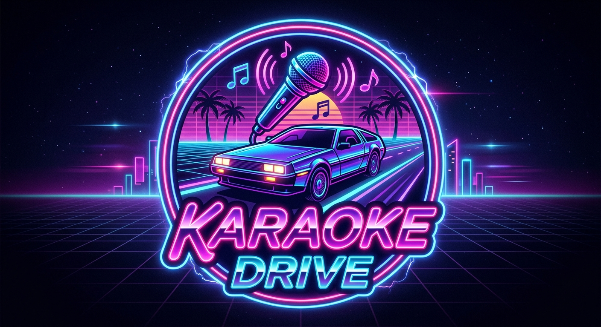

# KaraokeDrive

Karaoké pour la voiture, sur Android et Android Auto. L'application reconnaît le morceau qui passe
(radio, autoradio, application de musique), puis affiche ses paroles synchronisées mot par mot,
avec une boule qui rebondit sur chaque mot, sur le téléphone et sur l'écran de la voiture.



## Fonctionnalités

- **Reconnaissance au micro** : empreinte audio de type Shazam calculée sur le téléphone ; ACRCloud
  sert de secours si une clé est fournie.
- **Suivi d'une application média** (Spotify, Deezer…) : quand l'application publie sa position de
  lecture, la synchronisation se fait sans micro.
- **Paroles synchronisées** : LRCLIB pour les lignes, Kugou pour le minutage mot par mot. Les
  lignes s'affichent tout de suite, puis la version mot par mot les remplace dès qu'elle arrive.
- **Traduction française** des paroles : ML Kit sur le téléphone, ou une IA au format OpenAI
  (Gemini par défaut) si une clé est fournie.
- **Favoris et mode entraînement** : réviser les paroles d'un morceau enregistré, sans musique,
  avec pause, retour, avance et vitesse réglable.
- **Android Auto** : la scène karaoké est dessinée sur l'écran de la voiture.

## Statut et avertissements

Prototype personnel, non publié sur Google Play.

- La reconnaissance Shazam et les paroles Kugou passent par des **API non officielles**, et LRCLIB
  est une base communautaire : réservé à un **usage personnel**.
- Android Auto n'affiche une application construite avec la Car App Library que si elle vient
  d'une source reconnue, comme Google Play. La voie officielle pour un essai en voiture est le
  partage interne de Google Play. Le simulateur Android Auto (DHU) affiche l'application quelle
  que soit son installation. En voiture, déclarer le Play Store comme installateur lors d'une
  installation par ADB (`adb install -r -i com.android.vending app-release.apk`) est une piste
  qui n'est pas encore confirmée.
- L'écran voiture utilise la catégorie « navigation » pour dessiner librement : en l'état, ce
  choix ne passerait pas l'examen de Google Play.

## Compiler

Prérequis : JDK 17 ou plus récent, et le SDK Android. Gradle télécharge lui-même la plate-forme
SDK manquante.

```bash
./gradlew assembleDebug
```

```bash
./gradlew testDebugUnitTest
```

Les clés facultatives se placent dans `local.properties`, qui n'est jamais commité :

| Clé | Rôle |
|---|---|
| `acr.host`, `acr.accessKey`, `acr.accessSecret` | Reconnaissance ACRCloud de secours |
| `llm.apiKey` (et `llm.baseUrl`, `llm.model`) | Traduction par IA |

Sans aucune clé, l'application fonctionne avec Shazam, LRCLIB, Kugou et la traduction ML Kit.
Les clés se retrouvent dans l'APK compilé : ne le diffusez pas.

## Licence

Distribué sous licence [GPL-3.0](LICENSE). Les composants tiers et leurs licences sont listés dans
[THIRD_PARTY_NOTICES.md](THIRD_PARTY_NOTICES.md).

Auteur : Sébastien Gromy, également créateur du logo.
